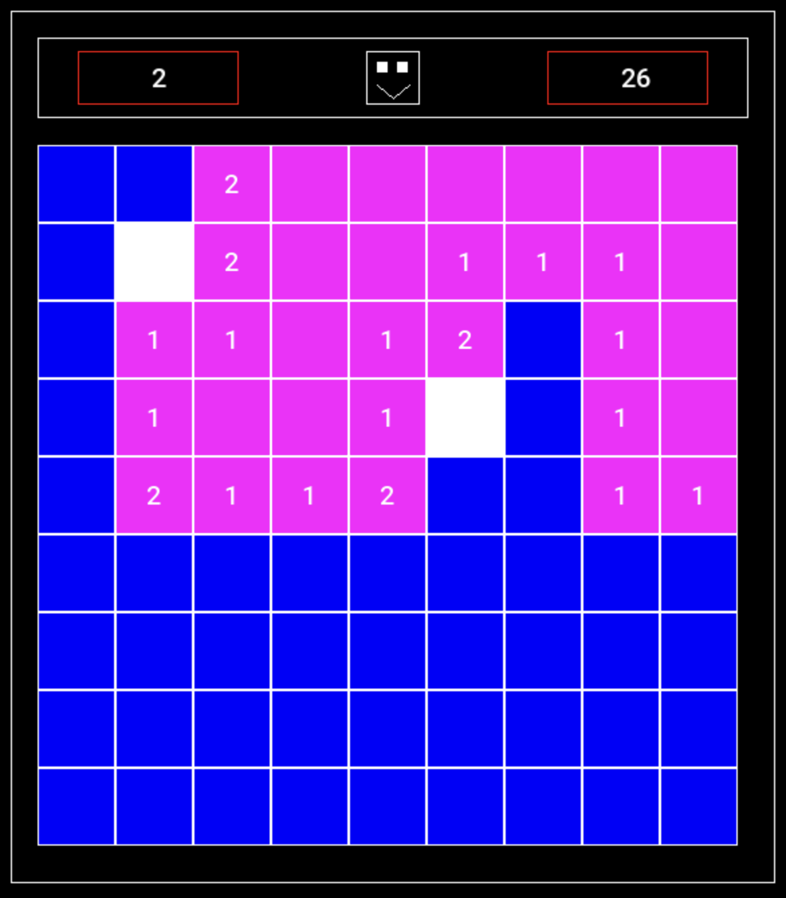
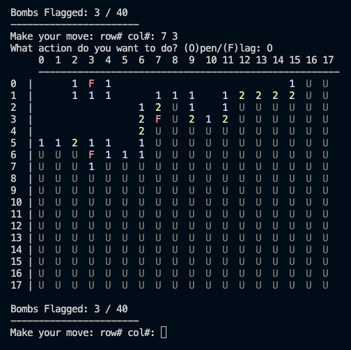

# Minesweeper

Minesweeper in C++, with two versions: an SDL2 GUI and a terminal version. They share the same game logic (`Board` and `Cell` in `src/`), so the GUI and terminal code only handle input and drawing.

The GUI is a 9×9 board with 10 mines, a flag counter and a timer (adding multiple levels is the next step). The terminal version has easy, medium and hard.

<p>
  
  
</p>

## Building

You need a C++17 compiler, CMake, and SDL2 + SDL2_ttf for the GUI. On a Mac:

```bash
brew install cmake sdl2 sdl2_ttf
```

I set up a make file to easily compile and run the different versions:

| Command             | What it does                    |
| ------------------- | ------------------------------- |
| `make gui`          | Build the GUI                   |
| `make terminal`     | Build the terminal version      |
| `make run-gui`      | Build and run the GUI           |
| `make run-terminal` | Build and run the terminal one  |
| `make clean`        | Delete `build/`                 |

Run things from the repo root.

## Playing

**GUI:** left click opens a cell, right click places or removes a flag. Flags placed are shown top left and the timer top right. When the game ends the window closes and prints whether you won or lost in the terminal.

**Terminal:** pick a difficulty (E is 10×10 with 10 mines, M is 18×18 with 40, H is 24×24 with 99), then enter moves as `row col` followed by `O` to open or `F` to flag. `U` is an unopened cell. Type `100 100` to quit.


## Project structure

```
.
├── CMakeLists.txt
├── Makefile
├── assets/fonts/      # Roboto + its license
├── docs/images/       # screenshots for this readme
└── src/
    ├── cell.h/.cpp    # a single cell
    ├── board.h/.cpp   # the game logic
    ├── gui.cpp        # SDL2 version
    └── terminal.cpp   # terminal version
```

## Font

The GUI uses Roboto Medium (Copyright 2011 Google Inc.), licensed under Apache 2.0. The license is in `assets/fonts/LICENSE.txt`.
